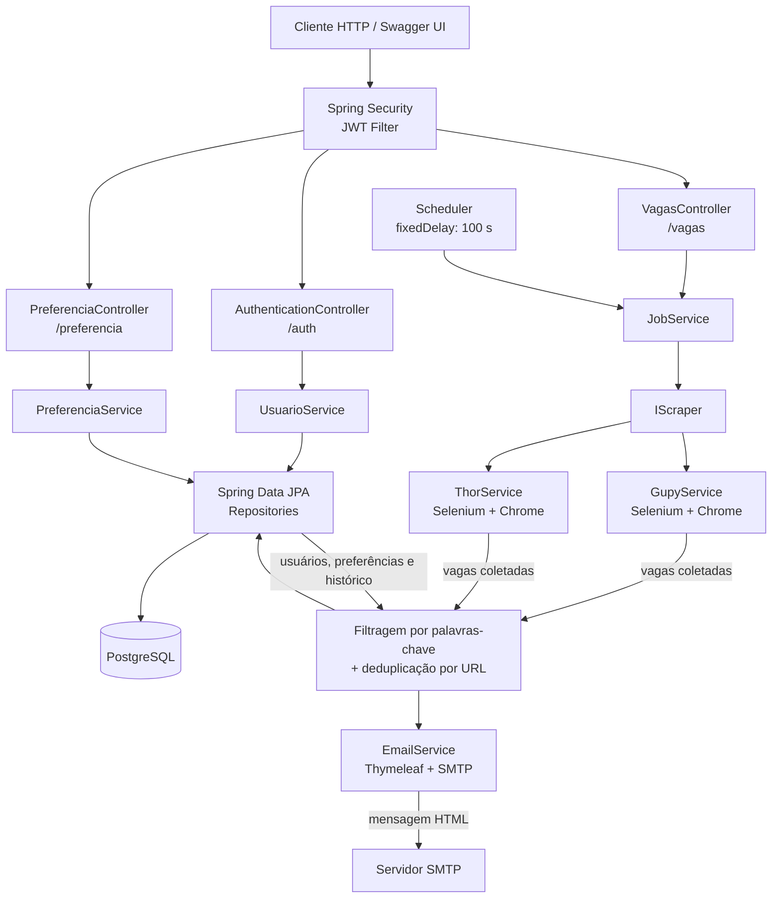

# Monitor de Vagas

API backend para monitorar oportunidades de emprego em diferentes plataformas, cruzar as vagas encontradas com as preferências de cada usuário e enviar notificações por e-mail apenas quando houver novas oportunidades relevantes.

O projeto foi construído como uma aplicação Spring Boot modular, com autenticação stateless via JWT, persistência em PostgreSQL, scraping automatizado com Selenium e execução periódica do monitoramento em background.

## Visão geral

O Monitor de Vagas resolve um problema recorrente de busca manual em portais de emprego:

1. O usuário cria uma conta e informa as palavras-chave de interesse.
2. A aplicação coleta vagas nas fontes configuradas.
3. As vagas são filtradas pelas preferências individuais.
4. O histórico de vagas já enviadas é consultado para evitar duplicidade.
5. Um e-mail HTML é enviado quando existem novas oportunidades.

Além do fluxo automático, a API permite pesquisar vagas sob demanda.

## Arquitetura

O sistema segue uma separação em camadas inspirada em arquitetura hexagonal/clean architecture:

- **Presentation**: controllers REST e DTOs de entrada e saída.
- **Business**: casos de uso, regras de negócio, agendamento e interfaces de integração.
- **Infrastructure**: entidades JPA, repositórios, segurança, configurações, conversores e integrações externas.

### Diagrama da arquitetura atual



## Funcionalidades

### Gestão de usuários e autenticação

- Cadastro de usuário com nome, e-mail único e senha criptografada com BCrypt.
- Login com e-mail e senha.
- Emissão de token JWT com validade de uma hora.
- Proteção dos endpoints de negócio com Spring Security.
- API stateless, sem sessão de servidor.

### Preferências de vagas

- Associação de palavras-chave ao usuário autenticado.
- Exemplo: `Desenvolvedor Java`, `Backend`, `Spring Boot`.
- As preferências são utilizadas no processamento automático e na seleção das vagas relevantes.

### Coleta de vagas

- Scraping headless com Selenium e Chrome.
- Coleta na Gupy com navegação por páginas.
- Coleta no ProgramaThor com paginação e limite de até 600 vagas por execução.
- Extração de título, empresa, data de publicação quando disponível e URL da vaga.
- Interface `IScraper` para padronizar futuras fontes de vagas.

### Filtragem e deduplicação

- Comparação das palavras-chave com o título da vaga.
- Consolidação das vagas obtidas de diferentes fontes.
- Registro das vagas notificadas por usuário.
- Restrição única no banco para o par `(usuário, URL da vaga)`.
- Prevenção de envio repetido da mesma oportunidade em execuções futuras.

### Notificações

- E-mail HTML utilizando Thymeleaf.
- Template em `src/main/resources/templates/notificacao.html`.
- Envio por SMTP configurável.
- Mensagem personalizada com nome do usuário, quantidade de vagas e links.

### API e documentação

- Endpoints REST documentados com OpenAPI/Swagger.
- Tratamento global de exceções.
- Respostas em DTOs, evitando expor diretamente o modelo da API.

## Fluxos principais

### Monitoramento automático

O `JobService` é executado a cada 100 segundos (`fixedDelay = 100000`). A cada execução:

1. `GupyService` e `ThorService` coletam as vagas disponíveis.
2. A aplicação carrega os usuários, suas preferências e o histórico de notificações.
3. As vagas são filtradas por título e palavra-chave.
4. Vagas já enviadas são removidas da notificação atual.
5. Novas vagas são persistidas em `vaga_recebida`.
6. O `EmailService` renderiza o template e envia o e-mail.

Se uma fonte falhar, o serviço registra o erro e tenta continuar com as demais fontes. Caso nenhuma fonte produza resultados, a aplicação sinaliza que não há vagas disponíveis.

### Pesquisa manual

O endpoint `POST /vagas/pesquisar` recebe uma lista de palavras-chave e realiza uma pesquisa sob demanda. No estado atual, esse fluxo consulta a Gupy e retorna os resultados diretamente, sem substituir o histórico do processamento automático.

## Modelo de dados

```text
Usuario
 ├── 1:N Preferencia
 └── 1:N VagaRecebida

VagaRecebida
 ├── usuario
 ├── titulo_vaga
 └── url_vaga
```

As entidades principais são:

| Entidade | Responsabilidade |
| --- | --- |
| `Usuario` | Credenciais, identidade e relacionamentos do usuário |
| `Preferencia` | Palavras-chave cadastradas pelo usuário |
| `VagaRecebida` | Histórico de vagas já notificadas |

## Endpoints

| Método | Rota | Autenticação | Descrição |
| --- | --- | --- | --- |
| `POST` | `/auth/register` | Não | Cadastra usuário via parâmetros `nome`, `email` e `senha` |
| `POST` | `/auth/login` | Não | Valida credenciais e retorna um JWT |
| `POST` | `/preferencia` | JWT | Cadastra uma preferência via `nomePreferencia` |
| `POST` | `/vagas/pesquisar` | JWT | Pesquisa vagas por uma lista JSON de palavras-chave |
| `GET` | `/swagger-ui.html` | Não | Interface interativa da documentação |
| `GET` | `/v3/api-docs` | Não | Especificação OpenAPI em JSON |

## Stack tecnológica

| Categoria | Tecnologia |
| --- | --- |
| Linguagem | Java 21 |
| Framework | Spring Boot 4.1 |
| API | Spring Web MVC |
| Segurança | Spring Security, JWT e BCrypt |
| Persistência | Spring Data JPA, Hibernate e PostgreSQL 17 |
| Web scraping | Selenium WebDriver e Google Chrome headless |
| E-mail | Spring Mail, Jakarta Mail e SMTP |
| Templates | Thymeleaf |
| Mapeamento | MapStruct |
| Documentação | Springdoc OpenAPI / Swagger UI |
| Build | Gradle 9.5.1 Wrapper |
| Containerização | Docker e Docker Compose |
| Testes | JUnit e testes Spring MVC |

## Estrutura do projeto

```text
src/
├── main/
│   ├── java/arthurrodrigues/monitorvagas/
│   │   ├── business/
│   │   │   ├── interfaces/       # Contratos das integrações de scraping
│   │   │   ├── service/          # Casos de uso e regras de negócio
│   │   │   └── utils/            # Utilitários de scraping e segurança
│   │   ├── infrastructure/
│   │   │   ├── config/           # Configurações Spring e OpenAPI
│   │   │   ├── converter/        # Conversão entidade <-> DTO
│   │   │   ├── entity/           # Entidades persistidas
│   │   │   ├── exception/        # Exceções e handler global
│   │   │   ├── repository/       # Repositórios JPA
│   │   │   ├── scraper/          # Gupy e ProgramaThor
│   │   │   └── security/         # JWT e filtro de autenticação
│   │   └── presentation/
│   │       ├── controller/       # Endpoints HTTP
│   │       └── dto/              # Contratos da API
│   └── resources/
│       ├── application.yaml      # Configuração por variáveis de ambiente
│       ├── templates/            # E-mails Thymeleaf
│       └── static/               # Recursos estáticos
└── test/                         # Testes unitários e de controllers
```

## Configuração

Nunca versionar o `.env`. Use `.env.example` como referência:

| Variável | Finalidade |
| --- | --- |
| `APPLICATION_PORT` | Porta HTTP da aplicação |
| `SPRING_DATASOURCE_URL` | URL JDBC do PostgreSQL |
| `SPRING_DATASOURCE_USERNAME` | Usuário do banco |
| `SPRING_DATASOURCE_PASSWORD` | Senha do banco |
| `POSTGRES_PORT` | Porta publicada pelo container do PostgreSQL |
| `URL_GUPY_VAGAS` | URL base usada pelo scraper da Gupy |
| `URL_THOR_VAGAS` | URL base usada pelo scraper do ProgramaThor |
| `SECRET_KEY_JWT` | Chave utilizada para assinar tokens JWT |
| `EMAIL_REMETENTE` | Nome exibido no remetente |
| `EMAIL_USERNAME` | Conta SMTP usada no envio |
| `EMAIL_HOST` | Host do servidor SMTP |
| `EMAIL_PORT` | Porta SMTP |
| `EMAIL_PASSWORD` | Credencial SMTP |

As credenciais devem ser fornecidas por variáveis de ambiente ou por um mecanismo seguro de secrets em ambientes de produção.

## Testes

Execute a suíte existente com:

```powershell
.\gradlew.bat test
```

Os testes cobrem serviços de negócio e controllers, incluindo autenticação, preferências, consulta de vagas, usuários e envio de e-mails.

## Licença e autoria

Projeto desenvolvido por **Arthur Rodrigues Ramos**.

- GitHub: [arthurrodriguessdev](https://github.com/arthurrodriguessdev)
